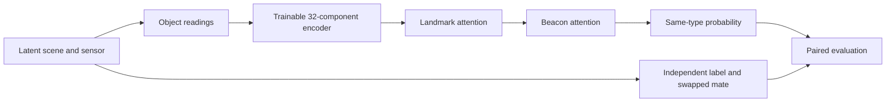

# Trigintaduonion neural network

Can knowing how a sensor mixes its 32 channels help a neural network answer a spatial question? Two beacons each select an object through a nearby landmark. A graph classifier learns whether the selected objects have the same hidden type from their positions and noisy sensor readings. Swapping one selected object's reading with a distractor reverses the answer.

The **primary comparison** crosses two independently rendered sensor rules with two end-to-end models. Canonical Cayley–Dickson multiplication and a randomized high-dimensional rule use the same coefficient budget. A full network has a learned sensor encoder, two residual geometric message-passing blocks and a symmetric readout. Clinical, physical or natural-image interpretations of the synthetic sensor require independent evidence.

[Protocol](reports/preregistration.md) · [Run matrix](reports/planned-runs.md) · [Literature](reports/literature-review.md) · [Methods](reports/state-of-the-art-review.md) · [Progress](reports/progress.md)

Prior work covers [real](https://arxiv.org/abs/1512.03385), [complex](https://arxiv.org/abs/1705.09792), [quaternion](https://arxiv.org/abs/1712.04604), [octonion](https://doi.org/10.1016/j.neucom.2020.02.053), and [sedenion](https://arxiv.org/abs/2012.03874) networks. Our test combines spatial attribute comparison with an intervention on the sensor's multiplication rule. [CLEVR](https://cs.stanford.edu/people/jcjohns/clevr/) · [Distance-based graph learning](https://proceedings.mlr.press/v139/satorras21a.html)

## Study matrix

Pilot the full graph network, then cross true/randomized channel mixing. Follow with real and shallow controls, dimensional ablation, sample-size sensitivity, multiplier recovery, blind product learning, superpixel graphs and raw-image CIFAR-10/ciFAIR-10. The linked run matrix fixes split units, seeds, training budgets, and endpoints.

## Reproduction

Use Python 3.12 and uv, a local virtual environment and an optional ignored .env file. The reference GPU is an RTX 5070 Laptop GPU. Planned entry points are `uv run trig32 train`, `evaluate`, `predict`, and `report`. The implementation release supplies runnable examples and a lockfile. Publish generated evidence here as runs finish.

<!-- metrics:start -->
The project is at protocol publication. Model scores are pending.
<!-- metrics:end -->

## Work remaining

- Implement and validate the GPU pipeline and release the paper draft and explorer.
- Train and evaluate the pilot and registered runs. Document outcomes, limitations and failed attempts.
- Release reproducible weights, predictions and the final research report.
