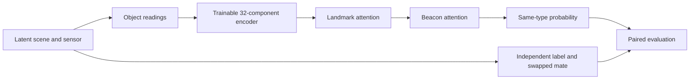

# Trigintaduonion neural network

Can knowing how a sensor mixes its 32 channels help a neural network answer a spatial question? Two beacons each select an object through a nearby landmark. A graph classifier learns whether the selected objects have the same hidden type from their positions and noisy sensor readings. Swapping one selected object's reading with a distractor reverses the answer.

The **primary comparison** crosses two independently rendered sensor rules with two end-to-end models. Canonical Cayley–Dickson multiplication and a randomized high-dimensional rule use the same coefficient budget. A full network has a learned sensor encoder, two residual geometric message-passing blocks and a symmetric readout. Clinical, physical or natural-image interpretations of the synthetic sensor require independent evidence.



[Interactive explorer](https://burnycoder.github.io/trigintaduonion-neural-network/) · [Paper](reports/paper.pdf) · [Model weights](https://huggingface.co/BurnyCoder/trigintaduonion-neural-network) · [Protocol](reports/preregistration.md) · [Run matrix](reports/planned-runs.md) · [Literature](reports/literature-review.md) · [Progress](reports/progress.md)

Prior work covers [real](https://arxiv.org/abs/1512.03385), [complex](https://arxiv.org/abs/1705.09792), [quaternion](https://arxiv.org/abs/1712.04604), [octonion](https://doi.org/10.1016/j.neucom.2020.02.053), and [sedenion](https://arxiv.org/abs/2012.03874) networks. Our test combines spatial attribute comparison with an intervention on the sensor's multiplication rule. [CLEVR](https://cs.stanford.edu/people/jcjohns/clevr/) · [Distance-based graph learning](https://proceedings.mlr.press/v139/satorras21a.html)

## Study matrix

Pilot the full graph network, then cross true/randomized channel mixing. Follow with real and shallow controls, dimensional ablation, sample-size sensitivity, multiplier recovery, blind product learning, superpixel graphs and raw-image CIFAR-10/ciFAIR-10. The linked run matrix fixes split units, seeds, training budgets, and endpoints.

## Reproduction

Use Python 3.12 and uv. The lockfile creates a local virtual environment. PyTorch runs on CUDA or CPU. Each run stores timestamped JSONL and TensorBoard metrics, resumable optimizer state, a portable safetensors checkpoint and per-example predictions. SciPy supplies the least-squares diagnostics and world-level intervals. The reference GPU is an RTX 5070 Laptop GPU.

```sh
uv sync --frozen
uv run pytest -q
uv run trig32 train --model cd32 --rule cd32 --seed 42
uv run trig32 evaluate scene-cd32-cd32-s42-n1024
uv run trig32 predict scene-cd32-cd32-s42-n1024 --input results/scene-cd32-cd32-s42-n1024/test-examples.json
uv run trig32 report
```

In another terminal, `uv run trig32 dashboard` serves live accuracy at <http://127.0.0.1:8765/>. The public explorer shows released results. Use `uv run trig32 matrix --stage all` for the whole study. [Installation, input schema, downloads and resumption](docs/usage.md) · [Experiment notebooks](reports/experiments/experiments.md) · [Research plan](reports/plan.md)

## Measured outcomes

<!-- metrics:start -->
The pilot has no released test prediction yet. The registered crossover awaits complete paired worlds.
<!-- metrics:end -->

## Research follow-up

- Inspect the paired crossover, the frozen and shallow controls, and out-of-distribution accuracy as the registered seeds finish.
- Compare sample-size sensitivity and the independent natural-image tasks.
- Localize any observed matching effect by intervening separately on the sensor encoder and the two graph update blocks in a new preregistration.
