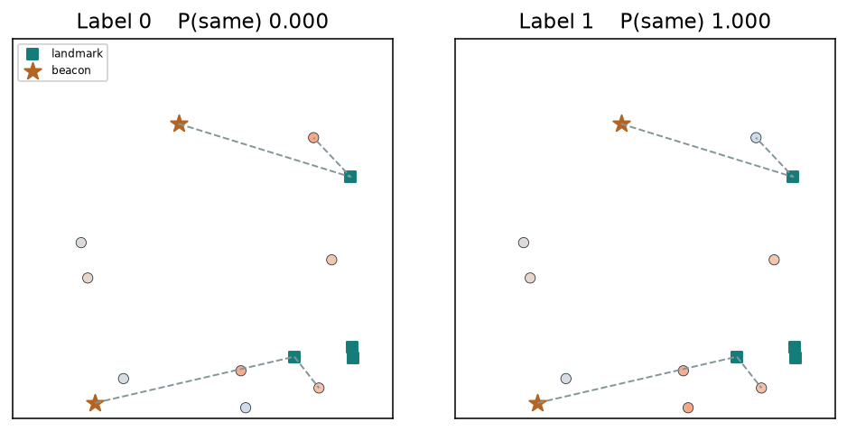
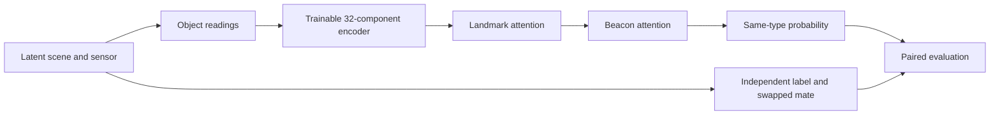
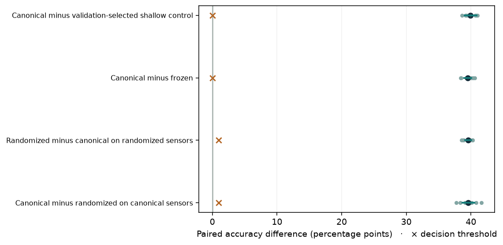
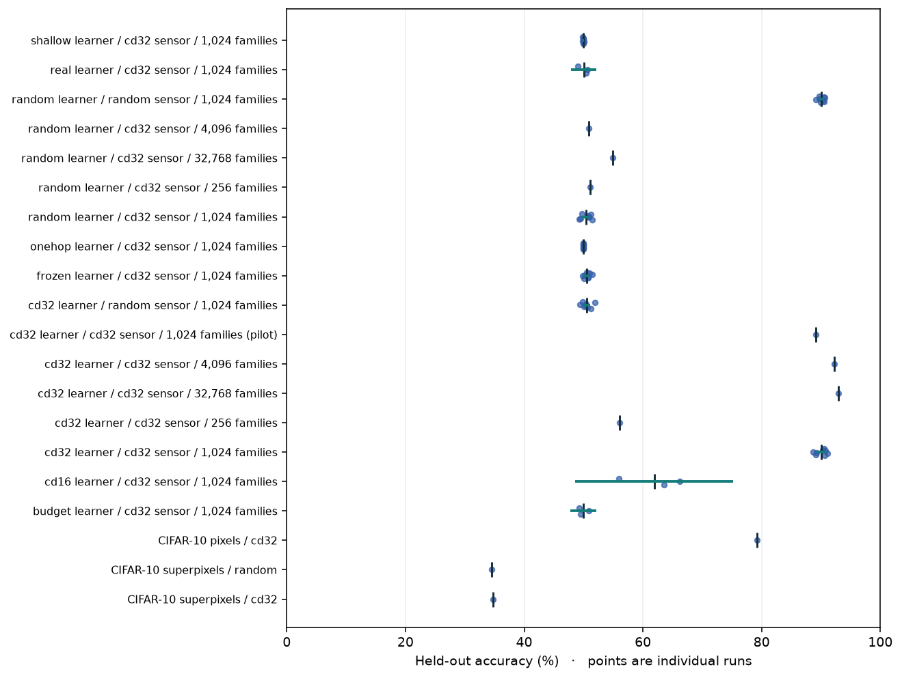
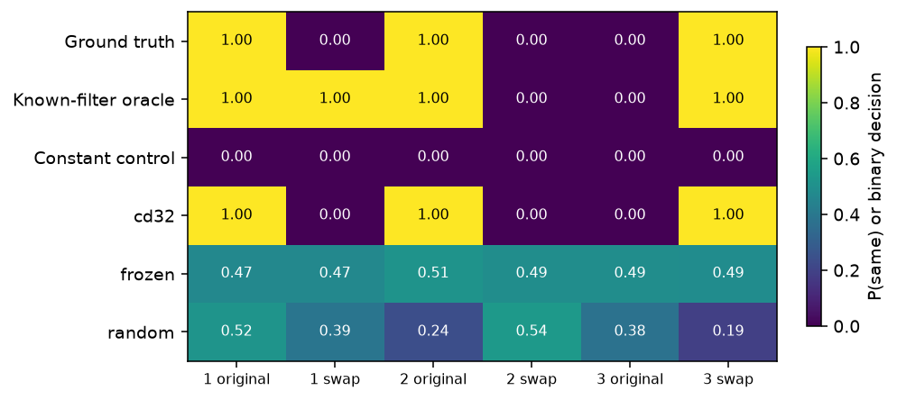
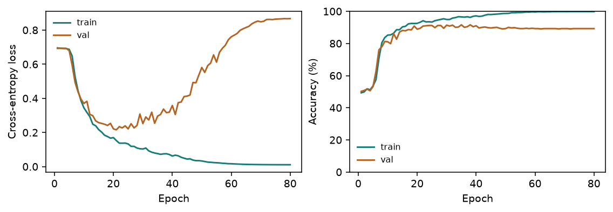
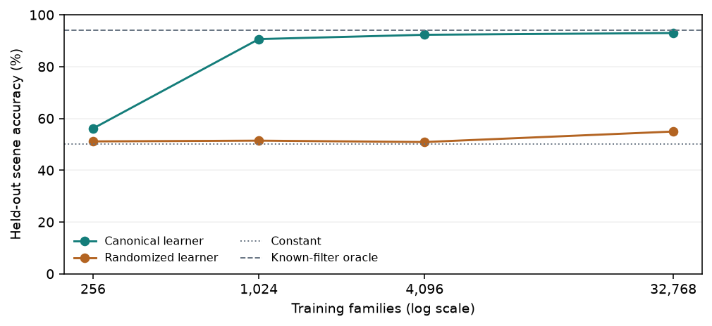

# Trigintaduonion neural network

Can knowing how a sensor mixes its 32 channels help a neural network answer a spatial question? Two beacons each select an object through a nearby landmark. A graph classifier learns whether the selected objects have the same hidden type from their positions and noisy sensor readings. Swapping one selected object's reading with a distractor reverses the answer.

<!-- highlights:start -->
Across 8 independent simulated worlds, a network matched to the canonical sensor classified 90.04% (95% interval 89.28% to 90.79%) of held-out scenes correctly. A network matched to the randomized sensor classified 90.06% (95% interval 89.63% to 90.49%) correctly. The mean benefit of matching the sensor rule was 39.59 percentage points on canonical sensors and 39.58 points on randomized sensors. Both directional matching criteria passed.



[Watch the two readings trade places in the first pilot pair](https://burnycoder.github.io/trigintaduonion-neural-network/figures/reading-swap.mp4)
<!-- highlights:end -->

The **primary comparison** crosses two sensor rules with two end-to-end models. Canonical Cayley–Dickson multiplication and a randomized rule use the same number of learned coefficients. A nonlinear sensor encoder feeds two geometric message-passing blocks and a symmetric readout. CIFAR-10 superpixels and raw CIFAR-10/ciFAIR-10 images provide independent transfer tests. The linear layer, convolution and graph classifier can also be used directly in PyTorch. [Layer definitions](src/trig32/algebra.py) · [Graph classifier](src/trig32/models.py) · [Python examples](docs/usage.md#using-the-pytorch-modules)



[Interactive explorer](https://burnycoder.github.io/trigintaduonion-neural-network/) · [Paper](reports/paper.pdf) · [Model weights](https://huggingface.co/BurnyCoder/trigintaduonion-neural-network) · [Protocol](reports/preregistration.md) · [Run matrix](reports/planned-runs.md) · [Literature](reports/literature-review.md) · [Progress](reports/progress.md)

Prior work covers [real](https://arxiv.org/abs/1512.03385), [complex](https://arxiv.org/abs/1705.09792), [quaternion](https://arxiv.org/abs/1712.04604), [octonion](https://doi.org/10.1016/j.neucom.2020.02.053), and [sedenion](https://arxiv.org/abs/2012.03874) networks. Our test combines spatial attribute comparison with an intervention on the sensor's multiplication rule. [CLEVR](https://cs.stanford.edu/people/jcjohns/clevr/) · [Distance-based graph learning](https://proceedings.mlr.press/v139/satorras21a.html)

## Study matrix

Pilot the full graph network, then cross true/randomized channel mixing. Follow with real and shallow controls, dimensional ablation, sample-size sensitivity, multiplier recovery, blind product learning, superpixel graphs and raw-image CIFAR-10/ciFAIR-10. The linked run matrix fixes split units, seeds, training budgets, and endpoints.

## Reproduction

Use Python 3.12 and uv. The lockfile creates a local virtual environment. PyTorch runs on CUDA or CPU. Each run stores timestamped JSONL and TensorBoard metrics, resumable optimizer state, a portable safetensors checkpoint and per-example predictions. SciPy supplies the least-squares diagnostics and world-level intervals. The reference GPU is an RTX 5070 Laptop GPU.

```sh
uv sync --frozen
uv run pytest -q
uv run trig32 train --model cd32 --rule cd32 --seed 42
uv run trig32 evaluate scene-cd32-cd32-s42-n1024
uv run trig32 predict scene-cd32-cd32-s42-n1024 --input results/scene-cd32-cd32-s42-n1024/test-examples.json
uv run trig32 report
```

In another terminal, `uv run trig32 dashboard` serves live accuracy at <http://127.0.0.1:18332/>. The public explorer shows released results. Use `uv run trig32 matrix --stage all` for the whole study. [Installation, input schema, downloads and resumption](docs/usage.md) · [Experiment notebooks](reports/experiments/experiments.md) · [Research plan](reports/plan.md)

## Measured outcomes

<!-- metrics:start -->










| Task / learner / sensor | Tested worlds | Trainable | Mean test | 95% interval |
| --- | --- | --- | --- | --- |
| graph / cd32 | 1 | 1694 | 34.80% | — |
| graph / random | 1 | 1694 | 34.55% | — |
| pixel / budget | 0 | 13115 | pending | — |
| pixel / cd16 | 0 | 22570 | pending | — |
| pixel / cd32 | 1 | 13034 | 79.21% | — |
| pixel / random | 0 | 13034 | pending | — |
| pixel / real | 0 | 308650 | pending | — |
| scene / budget / cd32 / 1024 families | 3 | 3961 | 49.92% | 47.73% to 52.10% |
| scene / cd16 / cd32 / 1024 families | 3 | 4057 | 61.90% | 48.57% to 75.22% |
| scene / cd32 / cd32 / 1024 families | 8 | 3801 | 90.04% | 89.28% to 90.79% |
| scene / cd32 / cd32 / 256 families | 1 | 3801 | 56.10% | — |
| scene / cd32 / cd32 / 32768 families | 1 | 3801 | 92.97% | — |
| scene / cd32 / cd32 / 4096 families | 1 | 3801 | 92.29% | — |
| scene / cd32 / cd32 / 1024 families (pilot) | 1 | 3801 | 89.16% | — |
| scene / cd32 / random / 1024 families | 8 | 3801 | 50.49% | 49.82% to 51.15% |
| scene / frozen / cd32 / 1024 families | 8 | 2113 | 50.56% | 50.10% to 51.01% |
| scene / onehop / cd32 / 1024 families | 8 | 3801 | 50.00% | 50.00% to 50.00% |
| scene / random / cd32 / 1024 families | 8 | 3801 | 50.45% | 49.75% to 51.14% |
| scene / random / cd32 / 256 families | 1 | 3801 | 51.12% | — |
| scene / random / cd32 / 32768 families | 1 | 3801 | 54.93% | — |
| scene / random / cd32 / 4096 families | 1 | 3801 | 50.88% | — |
| scene / random / random / 1024 families | 8 | 3801 | 90.06% | 89.63% to 90.49% |
| scene / real / cd32 / 1024 families | 3 | 11737 | 50.05% | 47.93% to 52.16% |
| scene / shallow / cd32 / 1024 families | 8 | 7713 | 49.96% | 49.89% to 50.03% |
<!-- metrics:end -->

## Research follow-up

- Preregister separate rule swaps in the sensor encoder and graph updates to localize the matching effect.
- Repeat the data-size comparison across fresh worlds with equal numbers of optimizer updates.
- Train across multiple hidden filters and evaluate on entirely new filters to measure between-world transfer.
